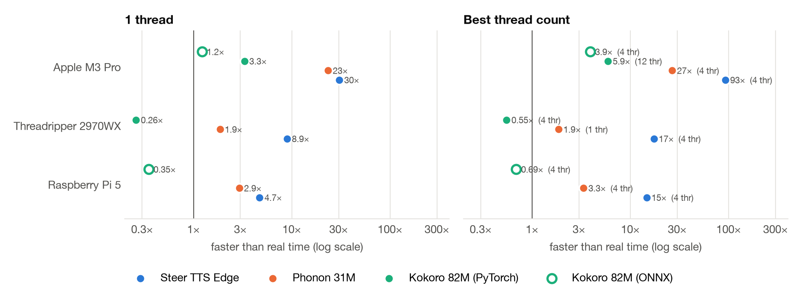
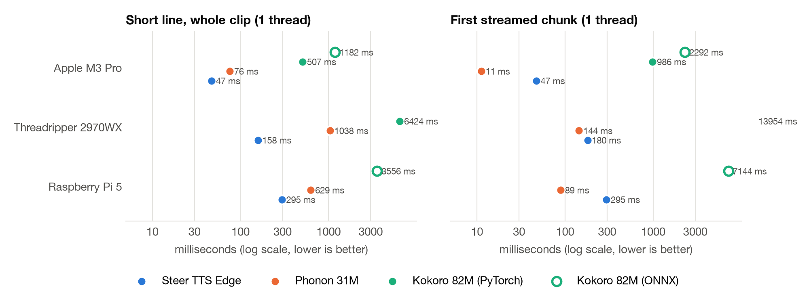
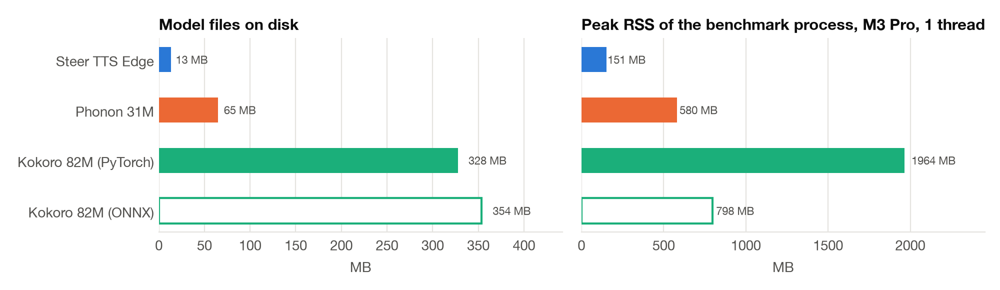
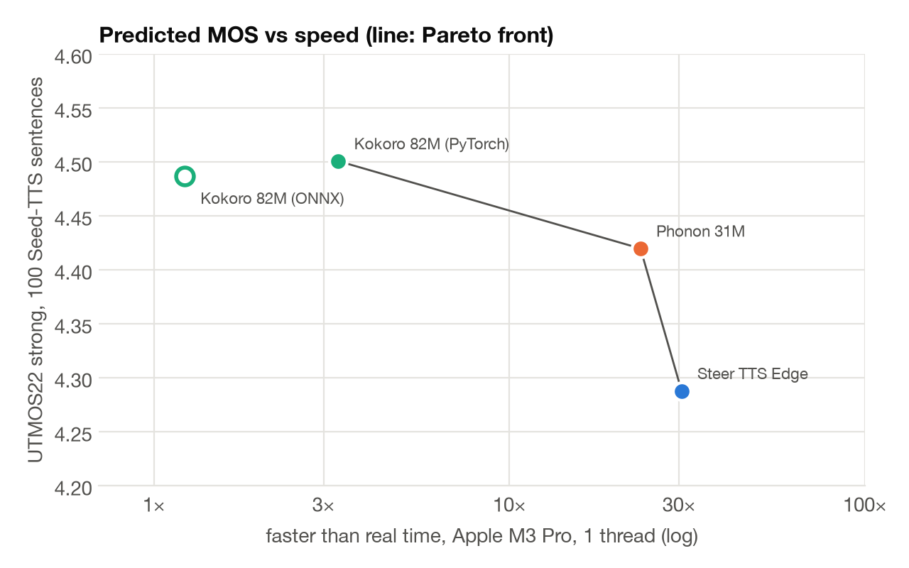

# Benchmarks: Steer TTS Edge vs other small open TTS models

Steer TTS Edge (C library v1.2.0) against the two smallest CPU models on the
[Open TTS Leaderboard](https://huggingface.co/spaces/hf-audio/open_tts_leaderboard):

| Model | Params | Files on disk | Licence | Runtime used |
|---|---|---|---|---|
| Steer TTS Edge | 9.6M + 6.2M vocoder (int4) | 13 MB | CC BY-NC 4.0 | C11 library (`c/`), called through ctypes |
| [Phonon 31M](https://huggingface.co/gradium/phonon-31m-en) | 31M (+ Mimi decoder) | 65 MB (q8 GGUF) | Apache 2.0 | `ptts` 0.6.0 (Rust, Python wheel) |
| [Kokoro 82M](https://huggingface.co/hexgrad/Kokoro-82M) | 82M | 328 MB | Apache 2.0 | `kokoro` 0.9.4 on PyTorch (official), and `kokoro-onnx` 0.6.1 on ONNX Runtime 1.31 |

**Method.** Each engine ran with its documented defaults (default voice; Kokoro `af_heart`), on CPU only, one fresh
process per engine and thread count. Every run uses the same protocol as `steertts --bench-json`
([bench_tts.py](benchmarks/bench_tts.py), [texts.json](benchmarks/texts.json)): two warm-up sentences, then five
renders of a short line, five streamed renders of a two-sentence probe, and the 20 bench sentences (about 66 s of
audio) rendered 2–3 times. The reported figure is the median pass. Speed is shown as x-real-time (audio seconds per
second of compute, so higher is faster). Quality was measured once per engine on 100 Seed-TTS-eval English sentences
plus three long paragraphs, scored with the leaderboard's own tools: Qwen3-ASR-1.7B WER (with Whisper large-v3-turbo
as a second ASR) and UTMOS22-strong. Raw data: [speed.csv](benchmarks/speed.csv),
[quality.csv](benchmarks/quality.csv), [runs.jsonl](benchmarks/runs.jsonl).

## Speed

x-real-time at 1 thread / at the best thread count (thread count in brackets):

| | Steer TTS Edge | Phonon 31M | Kokoro (PyTorch) | Kokoro (ONNX) |
|---|---|---|---|---|
| Raspberry Pi 5 (4 GB, no cooler) | **4.7× / 14.7×** (4) | 2.9× / 3.3× (4) | not run | 0.35× / 0.69× (4) |
| Threadripper 2970WX (shared, load ~40) | **8.9× / 17×** (4) | 1.9× / 1.9× (1) | 0.26× / 0.55× (4) | not run |
| Apple M3 Pro | **30× / 93×** (4) | 23× / 27× (4) | 3.3× / 5.9× (12) | 1.2× / 3.9× (4) |

## Time to first audio

1 thread. Whole clip for "Hello, how are you?" / first chunk of a streamed two-sentence request:

| | Steer TTS Edge | Phonon 31M | Kokoro (PyTorch) | Kokoro (ONNX) |
|---|---|---|---|---|
| Raspberry Pi 5 | **295 ms** / 295 ms | 629 ms / **89 ms** | – | 3.6 s / 7.1 s |
| Threadripper 2970WX | **158 ms** / 180 ms | 1.0 s / **144 ms** | 6.4 s / 14 s | – |
| Apple M3 Pro | **47 ms** / 47 ms | 76 ms / **11 ms** | 0.51 s / 0.99 s | 1.2 s / 2.3 s |

Phonon streams 80 ms frames, so its first chunk arrives well before the clip is finished. Steer and Kokoro stream
sentence by sentence: their first chunk is the first whole sentence. Kokoro's pipeline renders the two-sentence probe
as one segment, so its first chunk is later than its whole short line.

## Memory and size

Peak RSS is for the whole Python benchmark process, including the long paragraphs. Steer's own C CLI peaks at 27 MB
on the Pi and 48 MB on the M3 Pro. On the Pi, peak RSS was Phonon 265 MB and Kokoro ONNX 637 MB. Model load time on
the M3 Pro: Steer 0.03 s, Phonon 0.14 s, Kokoro ONNX 0.7 s, Kokoro PyTorch 5.7 s (mostly the imports).

## Quality

| 100 Seed-TTS sentences | Steer TTS Edge | Phonon 31M | Kokoro (PyTorch) | Kokoro (ONNX) |
|---|---|---|---|---|
| WER, Qwen3-ASR | 1.33 % | 1.42 % | 1.42 % | 1.42 % |
| WER, Whisper large-v3-turbo | 1.23 % | 1.52 % | 1.52 % | 1.33 % |
| UTMOS22 strong | 4.29 | 4.42 | **4.50** | 4.49 |

Intelligibility is a tie: the four differ by at most three word errors out of 1,047 words, and nearly all the
errors are rare proper names ("Caerleon", "Siepen", "Covedale") that every model misses. The MOS predictor ranks
Kokoro first, Phonon second and Steer third. Steer is on the Pareto front because it is the fastest.

## Caveats

- **Proxies.** ASR WER and UTMOS are automatic proxies, not listening tests, and UTMOS has its own taste. The quality
  renders came from the M3 Pro; the models are deterministic or seeded, so the output does not depend on the machine.
- **Thermal.** The Pi has no heatsink or fan. Steer's 3- and 4-thread runs hit the soft temperature limit, and so did
  three of the four competitor runs (each started below 65 °C and peaked at 81–88 °C). Over 10 sustained minutes at
  4 threads, Steer slows from 14× to about 8× real time; competitors were not run for 10 minutes.
- **Shared machines.** The Threadripper ran other jobs throughout (load 35–46 on 48 threads), and runs were pinned to
  4 cores of one NUMA node at nice 15. Read its numbers as pessimistic and compare rows with each other, not with
  other machines. M3 Pro runs taken while the 1-minute load was 10 or higher were discarded.
- **Partial coverage.** The Pi was available for a short window only, so Kokoro PyTorch was not run there and the
  competitors ran once each (1 and 4 threads). Kokoro ONNX was not run on the Threadripper.
- **Sources.** Steer's Pi numbers come from the C CLI's `--bench-json` (same sentences and protocol, released v1.2.0
  build). An unreleased build in draft PR #8 is about 2.3× faster on the Pi; it is not used here.
- **Versions.** Steer C library 1.2.0 with edge weights `WhissleAI/steer-tts-edge@1e4c2da`; `ptts` 0.6.0 with
  `gradium/phonon-31m-en@8c64b55`; `kokoro` 0.9.4 (torch 2.15 on macOS, 2.9.1 on Linux); `kokoro-onnx` 0.6.1 with
  `kokoro-v1.0.onnx`. Python 3.11 (Mac, Threadripper) and 3.13 (Pi). Threads were set with each engine's own control
  plus `OMP_NUM_THREADS`.

Reproduce one cell: `python -I docs/benchmarks/bench_tts.py --engine steer|phonon|kokoro|kokoro-onnx --model DIR
--threads N --out runs.jsonl`.
